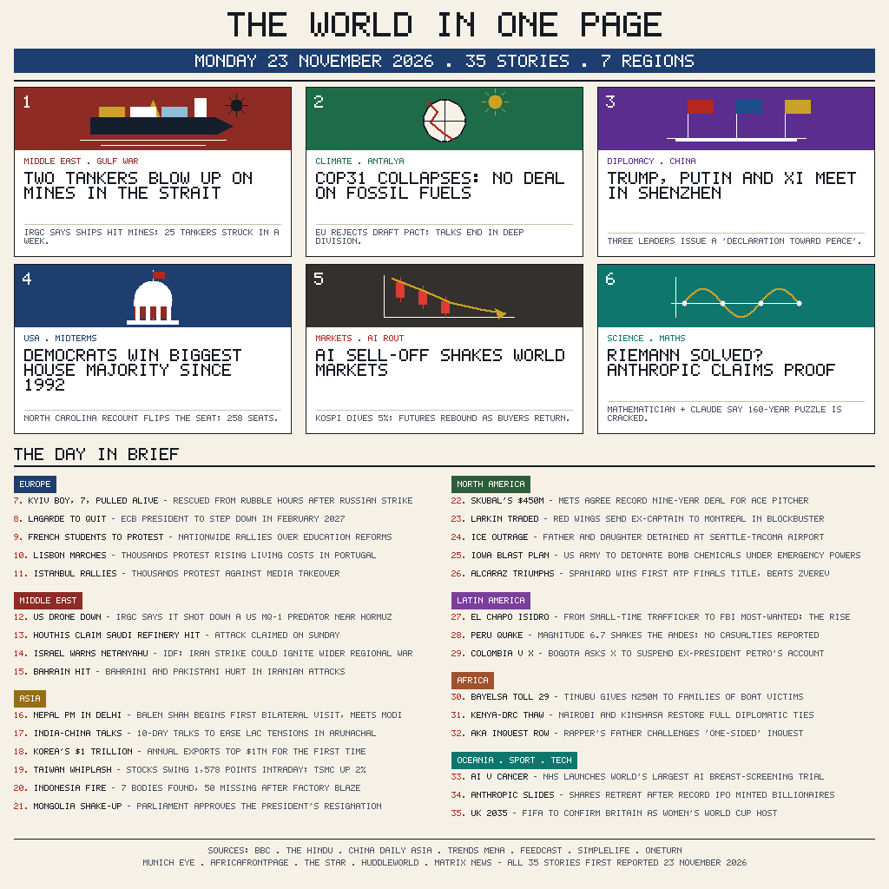

[](https://make.fun/bounty/news-image-20261123?utm_source=github&utm_medium=readme&utm_campaign=news-image-20261123)

[](https://make.fun/bounty/news-image-20261123/leaderboard?utm_source=github&utm_medium=readme&utm_campaign=news-image-20261123)

[](https://make.fun/bounty/news-image-20261123?utm_source=github&utm_medium=readme&utm_campaign=news-image-20261123)

# 23 November 2026 — The World in One Page (v4)

An entry for the [make.fun](https://make.fun/bounty/news-image-20261123)
competition **"Sum up 23 November's world news in one image"**.



## The day in six stories

All six events happened, or were first reported, on Monday 23 November 2026:

1. **Two tankers blow up on mines in the Strait** — the IRGC says two
   supertankers hit naval mines east of Hormuz; 25 tankers have been struck
   in the past week as the Gulf war spreads. (China Daily Asia, TRENDS MENA)
2. **COP31 collapses: no deal on fossil fuels** — the EU and other nations
   reject the draft climate pact in Antalya because it makes no explicit
   reference to fossil fuels; the talks end in deep division. (BBC, FeedCast)
3. **Trump, Putin and Xi meet in Shenzhen** — the three leaders hold a
   historic trilateral summit and issue a "Declaration toward Peace".
   (SimpleLife.news, OneTurn)
4. **Democrats win biggest House majority since 1992** — the party clinches
   at least 258 House seats after a North Carolina recount flips the seat.
   (BBC, OneTurn)
5. **AI sell-off shakes world markets** — a global AI rout sinks the KOSPI
   5% and hits Asian bourses; futures rebound as buyers return. (FeedCast)
6. **Riemann solved? Anthropic claims proof** — mathematician Levent Alpöge
   and Claude claim to have proved the Riemann Hypothesis, unsolved for over
   160 years. (SimpleLife.news)

## 29 more lines

**Europe**

- 07 — Boy, 7, pulled alive from rubble hours after a Russian strike on Ukraine. (BBC)
- 08 — Christine Lagarde to step down as ECB president in February 2027. (The Munich Eye)
- 09 — French students prepare nationwide protests over education reforms. (The Munich Eye)
- 10 — Thousands march in Lisbon as living costs fuel anger. (CareerIndia)
- 11 — Thousands rally in Istanbul against a media takeover. (OneTurn)

**Middle East**

- 12 — IRGC says it shot down a US MQ-1 Predator drone east of the Strait of Hormuz. (China Daily Asia)
- 13 — Houthis claim an attack on a Saudi oil refinery. (TRENDS MENA)
- 14 — IDF warns Netanyahu an Iran strike could ignite a wider regional war. (China Daily Asia)
- 15 — A Bahraini and a Pakistani hurt in Iranian attacks. (China Daily Asia)

**Asia**

- 16 — Nepal PM Balen Shah begins his first bilateral visit to India, meets Modi. (The Hindu)
- 17 — India and China hold 10-day talks to ease LAC tensions in Arunachal Pradesh. (The Hindu)
- 18 — South Korea's annual exports top $1 trillion for the first time. (SimpleLife.news)
- 19 — Taiwan stocks swing 1,578 points intraday; TSMC ends up over 2%. (SimpleLife.news)
- 20 — Seven bodies found, 50 missing after an Indonesian factory fire. (CareerIndia, Jagran Josh)
- 21 — Mongolia's parliament approves the president's resignation. (OneTurn)

**North America**

- 22 — Mets agree a record nine-year, $450 million deal for pitcher Tarik Skubal. (FeedCast)
- 23 — Red Wings trade ex-captain Dylan Larkin to Montreal in a blockbuster deal. (FeedCast)
- 24 — Father and daughter detained by ICE at Seattle-Tacoma airport; protests erupt. (FeedCast)
- 25 — US Army to detonate bomb-making chemicals in Iowa under emergency powers. (HuddleWorld)
- 26 — Carlos Alcaraz wins his first ATP Finals title, beating Alexander Zverev. (HuddleWorld)

**Latin America**

- 27 — "El Chapo Isidro": from small-time trafficker to one of the FBI's most wanted. (The Star / AP)
- 28 — Magnitude 6.7 earthquake shakes Peru's Andes; no casualties reported. (The Star)
- 29 — Colombia asks X to suspend ex-president Petro's account. (OneTurn)

**Africa**

- 30 — Bayelsa boat toll rises to 29; Tinubu gives N250m to victims' families. (Ships & Ports, Matrix News)
- 31 — Kenya and DRC agree to restore full diplomatic relations. (Radio Generation Kenya)
- 32 — AKA's father challenges the "one-sided" inquest into the rapper's death. (AfricaFrontPage / TimesLIVE)

**Oceania · Sport · Tech**

- 33 — NHS launches the world's largest AI breast-screening trial. (BBC)
- 34 — Anthropic shares retreat after a record IPO briefly minted decabillionaires. (FeedCast)
- 35 — FIFA to confirm the UK as host of the 2035 Women's World Cup. (BBC)

## How it works

`main.ts` (Node 22, zero dependencies) draws the whole 1024×1024 image:
a hand-authored 5×7 bitmap font, code-drawn pictograms (tanker and sea mine,
cracked globe, three summit flags, capitol dome, plunging market chart,
zeta zeroes), six numbered hero cards with a picture band each, and 29
one-line stories across 7 regions under colour-coded region chips. No
network, no external files.

```sh
mkdir -p out && MAKEFUN_OUTPUT_DIR=out node main.ts
```

Two runs write byte-identical PNGs (31,539 bytes,
sha256 `82b2ddfb5380feea4b14fde1876b32327ad27297c74638afdb50ce1dad7eb0b5`).

## Sources

BBC, The Hindu, China Daily Asia, TRENDS MENA, FeedCast, SimpleLife.news,
OneTurn, The Munich Eye, AfricaFrontPage, The Star, HuddleWorld, Matrix
News, Ships & Ports, Radio Generation Kenya, CareerIndia, Jagran Josh —
all stories dated 23 November 2026 (events of 23 November as first
reported that day).
